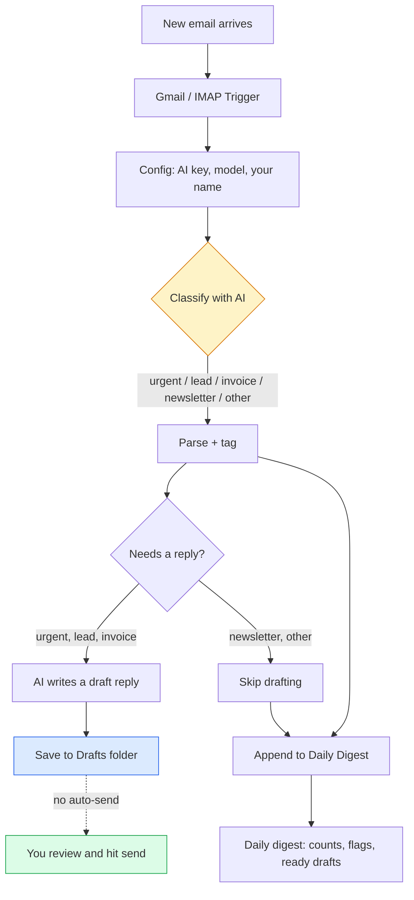

# AI Inbox Triage Starter Kit


**A free, self-serve starter kit that sorts your inbox with AI and writes reply drafts for you — without ever sending an email on its own.**

Import one [n8n](https://n8n.io) workflow, connect your inbox, add an AI key, and every new email gets read, labelled, and (when it deserves a reply) turned into a **draft you approve before it goes out**. Nothing auto-sends. Ever.

---

## Status

Last reviewed: October 2026 · release v2026.10

## Who this is for

You run a small business, agency, clinic, or shop. Your inbox is the front door — and it is buried. Leads sit unanswered for hours, invoices get lost under newsletters, and the one genuinely urgent email hides on page two. You do not want a bot firing off replies in your name. You want a **sharp assistant that pre-sorts everything and hands you ready-to-review drafts.**

That is exactly what this kit does.

## What you get (in 60 seconds)

- **Auto-classification** of every incoming email into 5 buckets: `urgent`, `lead`, `invoice`, `newsletter`, `other`.
- **Draft replies** written for the 3 types that actually need a response (urgent, lead, invoice) — saved to your Drafts folder, **never sent**.
- **A daily digest** that lists everything triaged, flags what needs a human, and shows which drafts are ready.
- **12 editable routing rules** in plain JSON — no code required to tune it to your business.
- **Bring-your-own AI key** — works with OpenAI, Groq (free tier), or Gemini. Swap the base URL, done.
- **Runs on your own n8n** (self-hosted free, or n8n Cloud). Your email never touches our servers.

## Architecture



The golden rule is the dashed line: **the workflow stops at your Drafts folder.** A human always sends.

## Quickstart (5 steps)

1. **Get n8n running** — [self-host free with Docker](https://docs.n8n.io/hosting/) or start a [cloud trial](https://n8n.io/cloud/). Takes about 5 minutes.
2. **Import the workflow** — in n8n: _Workflows -> Import from File_ -> pick [`workflows/inbox-triage-starter.n8n.json`](workflows/inbox-triage-starter.n8n.json).
3. **Connect your inbox** — open the two Gmail nodes, add your Gmail OAuth2 credential (IMAP works too — see [SETUP](docs/SETUP.md)).
4. **Add your AI key** — open the two `LLM` nodes, add an HTTP Header Auth credential (`Authorization: Bearer YOUR_KEY`). Free option: a [Groq key](https://console.groq.com). See [SETUP](docs/SETUP.md#swap-in-your-own-ai-key).
5. **Turn it on** — hit _Execute Workflow_ to test on your last unread emails, check your Drafts folder, then flip it Active.

Full walkthrough with screenshots-worth of detail: **[docs/SETUP.md](docs/SETUP.md)**.

## What is inside

```
ai-inbox-triage-starter/
├── README.md                             <- you are here
├── workflows/
│   └── inbox-triage-starter.n8n.json     <- the importable n8n workflow
├── docs/
│   ├── SETUP.md                          <- step-by-step install + safety notes
│   └── PROMPTS.md                        <- the exact AI prompts, copy-paste ready
├── rules/
│   └── triage-rules.example.json         <- the 12 routing rules, editable
├── LICENSE                               <- MIT
├── CONTRIBUTING.md
└── .gitignore
```

## Safety by design

- **Drafts-only.** The workflow creates drafts. It never calls a send action. You are always the last step.
- **Nothing auto-deletes or auto-archives.** It reads and labels; it does not touch your existing mail.
- **Your keys stay in your n8n.** Credentials live in your own instance. No secrets ship in this repo.
- **`needs_human` flag.** Anything involving money, legal, or a complaint gets flagged for your eyes first.

## Customize it

- Edit the 5 labels and 12 routing rules in [`rules/triage-rules.example.json`](rules/triage-rules.example.json).
- Tune the tone and guardrails of the drafts in [`docs/PROMPTS.md`](docs/PROMPTS.md).
- Point the digest at Slack, a Google Doc, or a database instead of plain text — it is one node.

---

## Want this done for you, on your real inbox?

This starter kit is the **lite, DIY version** of what we build for clients. It is genuinely useful on its own — but keeping it accurate, monitored, and safely wired into a live business inbox is a different job.

If you would rather have it **built, monitored, and done-for-you on your real inbox in 10 business days** — with human-escalation rules, your real tone of voice, and someone watching it so nothing slips — we do that.

> One recent client, a Belgian mining-logistics operator, paid in full and renewed on a retainer.

- Hire on Fiverr: https://www.fiverr.com/agencies/skynetjoellc
- Hire on Upwork: https://www.upwork.com/freelancers/muhammadwaseemnasir
- [Book a free systems audit](https://calendly.com/skynetlabs/schedule-a-free-consultation) — a 30-minute call, no pitch deck, just a look at your inbox and where the time is leaking.

Built by **SkynetLabs**. If this saved you an hour, a star helps other overwhelmed owners find it.
